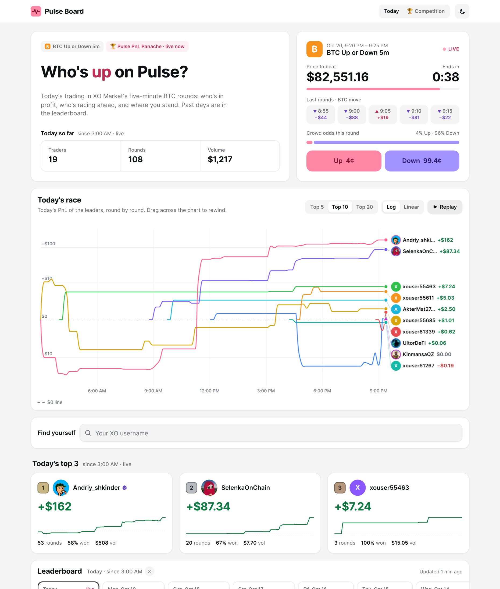
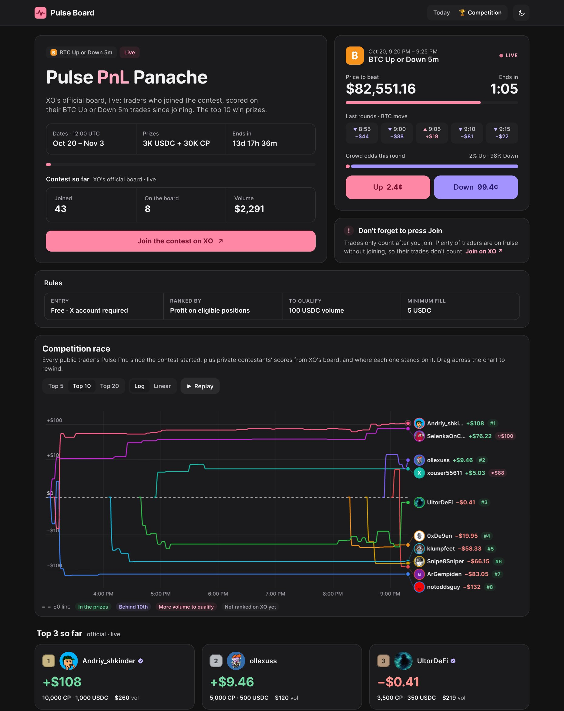
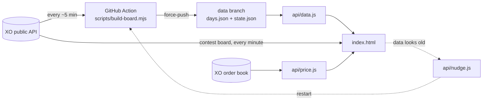

# Pulse Board

**Live PnL leaderboard for [XO Market](https://beta.xo.market) Pulse, the five-minute "BTC Up or Down" rounds.**
Who's in profit today, who's racing ahead, and where you stand, plus a live tracker for XO's trading contests.

**→ [xo-pulse-board.vercel.app](https://xo-pulse-board.vercel.app)** · competition view: [`/#competition`](https://xo-pulse-board.vercel.app/#competition)

<p align="center">
  
  
</p>

## Features

**Today**
- **Today's race**: a racing line chart of the leaders' PnL, round by round. Top 5 / 10 / 20, log or linear scale, drag to rewind, replay.
- **Live round**: price to beat, countdown, the last five rounds' BTC move, crowd odds and the best Up / Down asks from XO's order book.
- **Top 3 and the leaderboard**: every ranked trader with PnL, rounds, win rate and volume. The past 30 days are one click away.
- **Find yourself**: type your XO username to see your rank. **Share my rank** makes a card image or a short video of your PnL line, ready for X.
- Light and dark themes, phone-friendly, no cookies.

**Competition** (switched on in `config.json`, opened with the **Today | Competition** switch)
- **XO's official board**, read live from XO: only traders who pressed Join, scored by XO on their trades since joining, with each one's prize.
- **The race for everyone**: every public Pulse trader since the start, plus private contestants drawn from the scores XO publishes. A tag on each line says where they stand:

  | Tag | Meaning |
  |---|---|
  | 🟢 `#3` | rank on XO's board, in the prizes |
  | 🟣 `$12` | ranked, this far behind 10th place |
  | 🔴 `≈$40` | joined, about this much more volume to qualify |
  | ⚪ `–` | not on XO's board yet |
- **Full table**: XO's board first, then everyone else trading Pulse, with their PnL, the volume XO would count so far and what they still need.
- Rules, prize pool, a countdown before the start, live progress during the contest and the final standings after the end.

## How it works



- XO has no public Pulse leaderboard, so **the indexer** walks the Pulse rounds, collects who traded them and reads each trader's per-round PnL from their public portfolio. It ranks every UTC day and writes `data/days.json`, the only file the page reads. `state.json` keeps what was already fetched, so a normal run makes about 60 requests.
- **The Action** runs every ~5 minutes and force-pushes the data to the `data` branch as a single commit. Data updates never redeploy the site, and the history never grows.
- **The page** is one static `index.html` with no build step and no dependencies. During a contest it also reads XO's official board straight from XO once a minute.

## What counts

- A round belongs to the UTC day it opened on. It counts once it has opened and settled inside the window.
- PnL per round is the sum of the positions' `totalPnlInCollateral` from `/profiles/<user>/portfolio?marketScope=onlyClobPulse`. These are XO's own numbers, including limit-order fills and shares sold before the round ended, with fees left out. It is the same figure as "Net profit / loss" on XO's Pulse page: summed over a trader's whole history it matches to the cent (checked on 2026-10-10, 19,660.17 both ways over 5,494 rounds).
- A win counts once it is claimed, as on XO.
- Private profiles return an empty portfolio, so they aren't ranked. The page says how many there are.
- **Contest volume** for traders not yet on XO's board is an estimate: the sum of their buy and sell fills of at least the minimum size since the start. It is exact for anyone who joined before the start; XO counts only trades made after joining.
- The "Volume" tile adds up ranked traders' own stakes. It is not XO's market-wide volume, most of which is the market maker.

## Run it locally

```sh
node dev.mjs                  # http://localhost:8772, re-runs the indexer every 5 minutes
NO_REFRESH=1 node dev.mjs     # serve only
```

Node 18+, nothing to install.

## Deploy your own

1. Fork the repo and import it into [Vercel](https://vercel.com). The static page and `api/` functions need no settings.
2. Let the `board` Action run. It needs `contents: write`, which the workflow asks for itself.
3. Optional: add a `GH_TOKEN` env var in Vercel (fine-grained, **Actions: read and write** on this repo only). `api/nudge.js` uses it to restart the Action when GitHub skips its schedule, which happens often.
4. Optional: turn on Vercel Web Analytics (Analytics tab → Enable). The snippet is already in `index.html`.
5. Change `REF` at the top of the page script to your own referral link.

## Configuration

`config.json`:

| Key | What it does |
|---|---|
| `event.enabled` | `false`: plain Pulse statistics, nothing mentions a competition. `true`: adds the **Competition** view. |
| `event.name`, `event.prizes` | Title and prize line, e.g. `"3K USDC + 30K CP"`. |
| `event.url`, `event.slug` | XO's contest page and id. With a `slug` the view shows XO's official board, rules and prizes. |
| `start`, `end` | ISO dates (UTC). The window reaches back to `start` while an event is set. |
| `windowDays` | How many past days are (re)built. |
| `metric` | `pnl` (XO's portfolio PnL, default) or `net` (minus taker fees). |
| `exclude` | Usernames kept off the board, e.g. XO's market maker. |

To run a competition, put the dates in **before** it starts and push. If the window has to start in the past, rebuild it at home and publish it, because a full crawl is thousands of requests and Cloudflare blocks it from GitHub's servers:

```sh
FULL=1 node scripts/build-board.mjs && scripts/publish.sh
```

## Project layout

| Path | |
|---|---|
| `index.html` | The whole site. |
| `scripts/build-board.mjs` | The indexer (no dependencies). |
| `scripts/publish.sh` | Pushes local data to the `data` branch by hand. |
| `.github/workflows/board.yml` | Runs the indexer every ~5 min and publishes the data. |
| `api/data.js` | Serves `days.json` from the `data` branch through the GitHub API, because raw.githubusercontent caches files for 5 minutes. The page falls back to the raw file. |
| `api/price.js` | The live round's best asks. XO's order book only answers XO's own sites in the browser; this is edge-cached for 5 s, so XO gets one request per 5 s whatever the traffic. |
| `api/nudge.js` | Restarts the Action when the data gets old (with `GH_TOKEN`; at most once every 4 min). |
| `data/days.json` | A fallback copy of the data; the live copy is on the `data` branch. |
| `og/og-src.html` | Source of `og.png`, the link preview image. |
| `dev.mjs` | Local preview server. |

## XO API notes

- 100 requests per 10 s. The indexer stays at about 8 req/s.
- `/markets` returns at most 50 rows. Pages are newest-first, but rows inside a page are shuffled.
- `/markets/<id>/activity` lists taker trades only. Maker fills show up only in the portfolio.
- `/users/portfolio` ignores `page` for Pulse; `/profiles/<user>/portfolio` pages correctly.
- `/contests/<slug>/leaderboard` lists only qualified traders. There is no list of everyone who joined.

---

Built by **Andriy_shkinder** for the XO community, from XO's public data.
